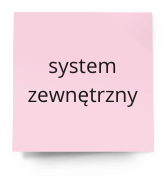

# EventStorming: Big Picture

## Przygotowanie:

- **Wybór uczestników**: Kluczowe jest zaproszenie osób, które dogłębnie rozumieją proces biznesowy.
- **Definiowanie celu**: Precyzyjne określenie zakresu analizy oraz tego, co pozostaje poza nią.
- **Tworzenie glosariusza**: Aby zapewnić spójność i jasność, warto ustalić i zapisywać kluczowe definicje, kreując wspólny język domenowy.

## Etapy warsztatu:

#### 1. **Wild Exploration**
- Swobodne mapowanie procesu poprzez zdarzenia, bez uwzględnienia ich chronologicznej kolejności.
- Facilitator może dodać pierwszą zdarzenie jako icebreaker.
- W tej fazie nie pracujemy razem tylko każdy z osobna.

- Warto docenić pracę uczestników. **Można zrobić krótką przerwę. **

#### 2. **Enforce Timeline**
- Organizacja zdarzeń w logicznej sekwencji, gdzie:
  - sortowanie przy użyciu (np. zdarzeń piwotowych) 
  - główna ścieżka procesu jest w centrum,
  - zebranie powtarzających się elementów blisko siebie,
  - kilka kluczowych zdarzeń może służyć jako punkty orientacyjne w układzie na osi czasu.

#### 3. **Actors and External Systems**
- Wskazanie aktorów zaangażowanych w proces oraz systemów zewnętrznych wpływających na jego przebieg.

#### 4. **Explicit Walk-Through**
- **Przegląd w przód**: Rekonstrukcja "szczęśliwej ścieżki" procesu, weryfikując kompletność modelu.
- **Przegląd w tył**: Analiza procesu od końca do początku, identyfikując zdarzenia prowadzące do kolejnych etapów.

#### 5. **Szanse i ryzyka**
- Analiza procesu pozwala na wskazanie szans i ryzyk związanych z jego obecną postacią.

## Gramatyka:

#### Zdarzenie - pomarańczowa kartka

- Kluczowa zmiana w analizowanym procesie.
- Opis w formie przeszłej dokonanej.

#### Hot Spot - różowa kartka

- Wszystkie niejasności, ryzyka i pytania. Zamiast wdawać się w długie dyskusje, warto je odnotować i wrócić do nich później.

#### Aktor - żółta kartka

#### System Zewnętrzny - niebieska kartka

